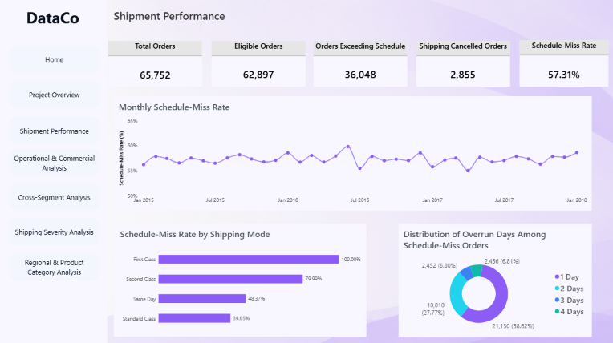
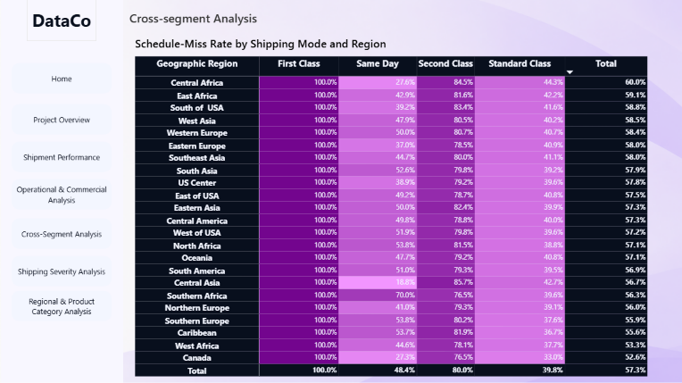
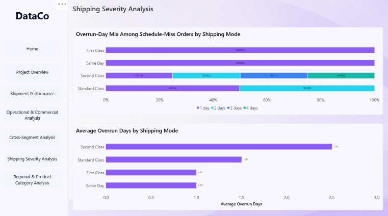
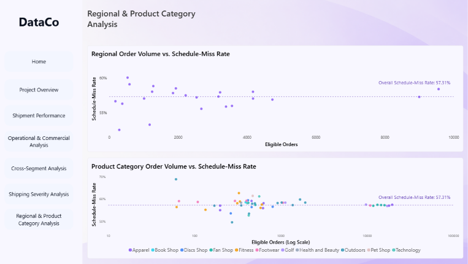
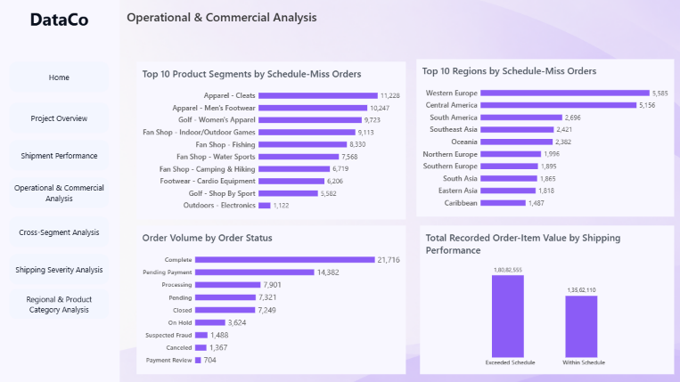
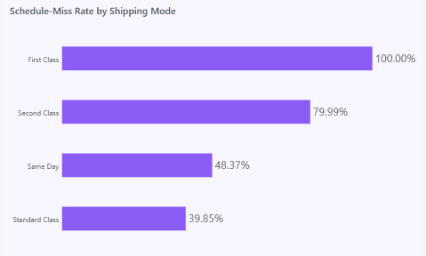
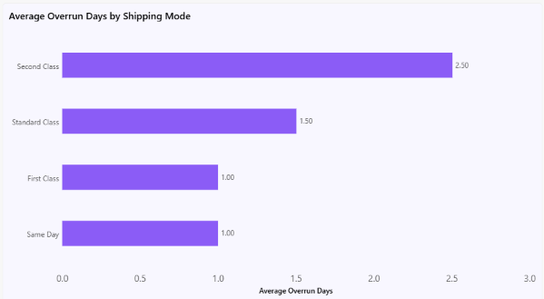
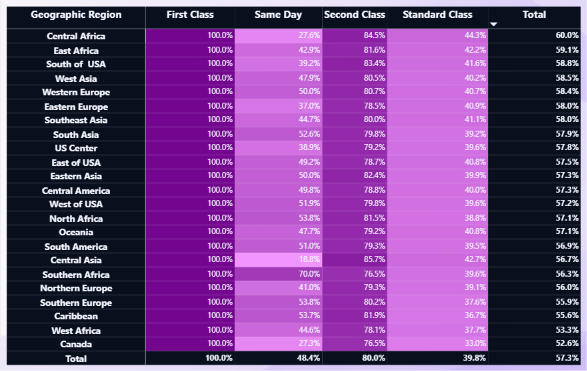
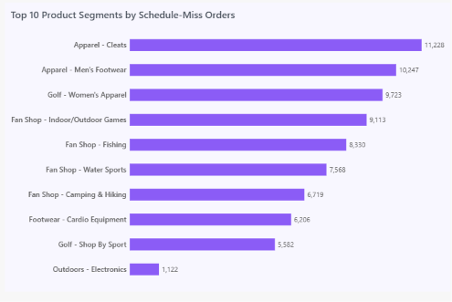
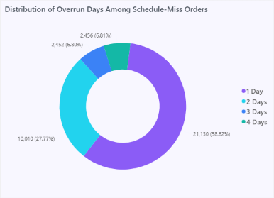

# DataCo Shipment Timing & Order Fulfillment Performance Analytics

**Supply Chain Analytics | PostgreSQL | Microsoft Power BI**

An order-level analysis of shipping-schedule adherence, delivery overruns, and fulfillment performance across shipping modes, regions, product categories, and time.

## Business Question

How does shipping-schedule adherence vary over time and across shipping modes, geographic regions, and product categories? How frequently do orders exceed their scheduled shipping durations, how severe are the overruns, and how do recorded order-item values compare between orders that exceed their schedules and those that do not?

## Executive Answer

**57.31% of eligible orders exceeded their scheduled shipping duration.** The results show that performance differs substantially by shipping mode and, for some modes, by region:

- **First Class:** 100.00% schedule-miss rate across all 23 regions. Its average overrun is one day, so the 100% rate should not be confused with the longest delay.
- **Second Class:** 79.99% schedule-miss rate and the highest average overrun at **2.50 days**. Its regional rates range from 76% to 86% in the exported matrix.
- **Standard Class:** Lowest overall mode-level schedule-miss rate (**39.85%**) but the highest number of schedule-miss orders (**14,995**) because it handles the largest eligible order volume.
- **Same Day:** The widest regional variation, from 19% in Central Asia to 70% in Southern Africa, based on whole-percentage values in the exported matrix.
- **Overrun severity:** **86.38%** of schedule-miss orders exceeded schedule by one or two days; 13.62% exceeded it by three or four days.
- **Commercial comparison:** Orders exceeding schedule account for 57.14% of recorded order-item value, close to their 57.31% share of eligible orders. Their average recorded value per order is slightly lower (501.62 versus 505.13). This is not evidence of delay-caused financial loss.

**Conclusion:** Schedule misses are widespread in the historical dataset, but the pattern is not uniform. Second Class is the clearest priority for investigation because it combines a high miss rate with the longest average overrun. First Class requires a review of its one-day schedule target and measurement definition, while Same Day warrants targeted regional investigation. Standard Class requires volume-aware monitoring because its lower rate still corresponds to the largest number of missed orders.

## Power BI Report — Selected Analytical Pages

The report contains seven pages. The following five pages contain the core analysis and are shown here; the Home and Project Overview pages are omitted because they are navigation and project-context pages rather than analytical outputs.

### 1. Shipment Performance

Overall KPIs, the 37-month schedule-miss trend, performance by shipping mode, and the distribution of overrun severity.

### 2. Cross-Segment Analysis

A 23-region by four-shipping-mode matrix comparing schedule-miss rates. This view shows where performance differences persist across geographic segments.

### 3. Shipping Severity Analysis

Compares the overrun-day mix and average overrun duration by shipping mode, distinguishing the frequency of missed schedules from the severity of overruns.

### 4. Regional & Product Category Analysis

Uses order-volume versus schedule-miss-rate comparisons to distinguish high-volume segments from segments with relatively high miss rates.

### 5. Operational & Commercial Analysis

Examines order status, the product segments and regions with the highest schedule-miss counts, and recorded order-item values across shipping-performance groups.

## Dataset

| Item | Detail |
|---|---|
| Dataset | DataCo SMART SUPPLY CHAIN FOR BIG DATA ANALYSIS |
| Source version | Mendeley Data, Version 5 |
| Source records | 180,519 item-level records |
| Source columns | 53 |
| Distinct orders | 65,752 |
| Average item records per order | 2.75 |
| Analysis period | January 2015 – January 2018 |

Raw source data files are not included in this repository.

## Methodology

1. **Data audit:** Reviewed record counts, duplicate records, missing values in key analytical fields, and consistency of order and shipping attributes.
2. **Data preparation in PostgreSQL:** Prepared order-level and item-level analytical datasets and the required summary tables.
3. **Metric definition:** Compared actual shipping duration with scheduled shipping duration at the order level. Shipping-canceled orders were excluded from the eligible denominator and reported separately.
4. **Segment analysis:** Evaluated monthly, shipping-mode, regional, product-category, order-status, and cross-segment performance.
5. **Severity and commercial analysis:** Measured overrun duration and compared recorded order-item values between schedule-miss and within-schedule orders.
6. **Power BI reporting and validation:** Built the semantic model, calculations, report visuals, and navigation; checked key aggregates against PostgreSQL results.

## Key Findings

### 1. Overall shipment performance

| Measure | Result |
|---|---:|
| Total distinct orders | 65,752 |
| Eligible orders | 62,897 |
| Orders exceeding schedule | 36,048 |
| Shipping-canceled orders | 2,855 |
| Schedule-Miss Rate | **57.31%** |
| Average overrun among late orders | **1.62 days** |

The monthly analysis covers 37 months. The Schedule-Miss Rate generally fluctuates around 55%–60%, with no sustained downward trend visible in the period reviewed. This indicates a recurring pattern in the historical data, but does not identify its operational cause.

### 2. Shipping-mode performance

| Shipping Mode | Scheduled Duration | Eligible Orders | Orders Over Schedule | Schedule-Miss Rate | Average Overrun |
|---|---:|---:|---:|---:|---:|
| First Class | 1 day | 9,602 | 9,602 | **100.00%** | 1.00 day |
| Second Class | 2 days | 12,256 | 9,803 | **79.99%** | **2.50 days** |
| Same Day | 0 days | 3,407 | 1,648 | **48.37%** | 1.00 day |
| Standard Class | 4 days | 37,632 | 14,995 | **39.85%** | 1.50 days |

#### Schedule-Miss Rate by Shipping Mode

#### Average Overrun Days by Shipping Mode

**Interpretation:** First Class has the highest miss rate, but not the longest overruns. Second Class is the strongest candidate for investigation because its miss rate is high and its average overrun is the largest. Standard Class has the lowest rate but the greatest absolute number of missed orders.

**Why the pattern may occur:** Scheduled durations differ by mode (zero, one, two, and four days). Shorter targets leave less time to meet the schedule and can produce higher miss rates even when the overrun itself is relatively short. The data supports this as a possible explanation, not a proven cause.

### 3. Cross-segment performance by region and shipping mode

The exported matrix contains all **92 combinations** of 23 regions and four shipping modes. Its rate values are rounded to whole percentages; the ranges below are therefore approximate.

| Shipping Mode | Regional Rate Range | Lowest Rate | Highest Rate | What the comparison shows |
|---|---:|---|---|---|
| First Class | 100%–100% | All 23 regions | All 23 regions | The 100% miss rate is consistent across the regions in the matrix. |
| Second Class | 76%–86% | Canada and Southern Africa (76%) | Central Asia (86%) | High miss rates are widespread, not confined to one region. |
| Same Day | 19%–70% | Central Asia (19%) | Southern Africa (70%) | This mode has the widest regional spread (51 percentage points). |
| Standard Class | 33%–44% | Canada (33%) | Central Africa (44%) | All regional rates are below the overall 57.31% benchmark. |

#### Regional Schedule-Miss Rate by Shipping Mode

**Interpretation:** First Class and Second Class show consistently high miss rates across regions. Same Day varies substantially by region, while Standard Class is comparatively lower in every region. Geography alone does not explain the pattern; shipping mode is an important segment to consider alongside region.

**Why the pattern may occur:** Differences could be associated with scheduled-duration expectations, dispatch cut-off times, route characteristics, local fulfillment capacity, or shipping-mode mix. The current matrix contains percentages but not the eligible-order denominator for every cell, so high-rate combinations should be checked against their order counts before operational resources are prioritised.

### 4. Regional order-level performance

| Region | Eligible Orders | Orders Over Schedule | Schedule-Miss Rate |
|---|---:|---:|---:|
| Western Europe | 9,563 | 5,585 | 58.40% |
| Central America | 9,001 | 5,156 | 57.28% |
| West Africa | 1,174 | 626 | 53.32% |
| Canada | 291 | 153 | 52.58% |

Western Europe and Central America contribute high missed-order counts alongside high order volumes. Canada has a lower count and a lower miss rate in these examples. A high count can result from a larger eligible-order base, a higher miss rate, or both; counts should not be interpreted as a performance rate.

### 5. Product-category performance

The following department–category combinations have the highest schedule-miss order counts in the Top 10 analysis.

| Department | Product Category | Orders Over Schedule |
|---|---|---:|
| Apparel | Cleats | 11,228 |
| Apparel | Men's Footwear | 10,247 |
| Golf | Women's Apparel | 9,723 |
| Fan Shop | Indoor/Outdoor Games | 9,113 |
| Fan Shop | Fishing | 8,330 |
| Fan Shop | Water Sports | 7,568 |
| Fan Shop | Camping & Hiking | 6,719 |
| Footwear | Cardio Equipment | 6,206 |
| Golf | Shop By Sport | 5,582 |
| Outdoors | Electronics | 1,122 |

#### Top Product Segments by Schedule-Miss Orders

Apparel–Cleats and Apparel–Men's Footwear have the highest counts among the displayed segments. These counts may reflect higher eligible-order volumes, higher schedule-miss rates, or both. The count-based ranking alone cannot distinguish those possibilities. Product-category order counts are non-additive because one order can contain products from multiple categories.

### 6. Schedule-overrun severity

| Overrun Duration | Orders | Share of Schedule-Miss Orders |
|---|---:|---:|
| 1 day | 21,130 | 58.62% |
| 2 days | 10,010 | 27.77% |
| 3 days | 2,456 | 6.81% |
| 4 days | 2,452 | 6.80% |
| **Total** | **36,048** | **100.00%** |

#### Distribution of Schedule-Overrun Severity

**Interpretation:** 86.38% of schedule-miss orders exceeded schedule by one or two days; the remaining 13.62% exceeded it by three or four days. The larger one- and two-day group represents the bulk of missed orders, while the smaller three- and four-day group represents the more severe overrun tail.

### 7. Commercial comparison

| Shipping Performance Group | Orders | Recorded Order-Item Value | Average Recorded Value per Order |
|---|---:|---:|---:|
| Exceeded Schedule | 36,048 | 18,082,555.30 | 501.62 |
| Within Schedule | 26,849 | 13,562,109.78 | 505.13 |

Orders exceeding schedule represent approximately **57.31% of eligible orders** and **57.14% of recorded order-item value**. Their average recorded value per order is approximately **0.69% lower** than the within-schedule group.

**Interpretation:** The larger total value for the exceeded-schedule group is broadly consistent with that group containing more orders. This comparison is descriptive; it does not measure delay-caused revenue loss, incremental cost, or profit impact.

### 8. Order-status context

The report includes order-status distribution as supporting context about the order lifecycle. Order status and delivery status represent different concepts; the status distribution is not treated as evidence that a particular processing status causes shipping overruns.

## Business Recommendations

| Priority | Recommended investigation or action | Evidence from the analysis |
|---|---|---|
| 1 | **Validate First Class target definition and execution.** Review the one-day scheduled target, the actual-duration calculation, and operational cut-off assumptions before treating the result as a carrier failure. | 100% schedule-miss rate in all 23 regions; average overrun is one day. |
| 2 | **Prioritise Second Class investigation.** Break down performance by route, fulfillment location, and carrier/transport hand-off where those details are available. | 79.99% overall miss rate and 2.50-day average overrun; regional rates reach 86%. |
| 3 | **Investigate Same Day regional variation.** Start with Southern Africa's 70% rate, compare it with lower-rate regions, and check eligible-order counts before prioritising action. | Same Day rates range from 19% to 70% in the exported matrix. |
| 4 | **Manage Standard Class by volume as well as rate.** Monitor the 14,995 missed orders and examine whether targeted improvements can reduce the absolute number without compromising its comparatively lower rate. | Lowest mode-level miss rate (39.85%), but the largest missed-order count. |
| 5 | **Use a two-level overrun response.** Address the high-volume one- and two-day overruns while separately reviewing the three- and four-day cases for more severe exceptions. | 86.38% of missed orders are one or two days over; 13.62% are three or four days over. |
| 6 | **Investigate product and regional segments using both volume and rate.** Add eligible-order denominators to segment reviews before interpreting high missed-order counts as poor performance. | Top product segments and high-volume regions have large missed-order counts; counts alone do not show the rate. |
| 7 | **Track the monthly rate as a baseline.** Monitor subsequent periods against the historical 55%–60% range and evaluate whether operational changes are followed by improvement. | No sustained downward trend is visible across the 37-month period reviewed. |
| 8 | **Keep commercial conclusions descriptive.** Add cost, margin, service-credit, or customer-impact data before estimating financial consequences of schedule misses. | Average recorded order-item value is slightly lower in the exceeded-schedule group; no delay-caused loss is measured. |

These are evidence-based investigation priorities, not claims that the dataset proves the root causes. Validate operational explanations with more detailed fulfillment, route, carrier, capacity, and cost information before implementing changes.

## Metric Definitions

- **Eligible Orders:** Distinct orders excluding shipping-canceled orders.
- **Orders Over Schedule:** Eligible distinct orders where actual shipping duration is greater than scheduled shipping duration.
- **Schedule-Miss Rate:** Orders Over Schedule divided by Eligible Orders.
- **Overrun Days:** Positive difference between actual and scheduled shipping duration for late-delivery orders. NULL is retained for advance, on-time, and canceled orders; it is not replaced with zero.
- **Average Overrun Days:** Average Overrun Days among schedule-miss orders.
- **Within Schedule:** Eligible orders that arrived in advance of or on their scheduled duration; shipping-canceled orders are excluded.

## Data Quality & Analytical Limitations

- The source contains 180,519 item-level records and 65,752 distinct orders; the average is 2.75 item records per order.
- No exact duplicate source rows were identified in the completed audit.
- The audited critical fields used for the analysis had no missing values in the checks performed.
- The order-level analysis separates 62,897 eligible orders from 2,855 shipping-canceled orders.
- All 36,048 late-delivery orders have a positive `overrun_days` value; observed overruns range from one to four days and average 1.62 days. NULL values for non-late and canceled orders are intentional under this definition.
- The regional-by-mode matrix export contains whole-percentage values. Its rates and ranges are presented as approximate; small differences should be checked using unrounded values.
- The matrix export contains rates but not eligible-order counts for each region–mode cell. Those denominators should be included in tooltips or a supporting table before making volume-sensitive decisions.
- Product-category order counts are non-additive because an order can contain items from multiple categories.
- Recorded order-item value is not equivalent to profit, incremental cost, or financial loss caused by a schedule miss.
- The analysis identifies patterns and investigation areas; it does not establish causal reasons for delays.

## Tools & Skills Demonstrated

- **PostgreSQL:** data loading, quality checks, data cleaning and transformation, order-level analysis, aggregation, and validation.
- **Power BI Desktop:** data modelling, DAX measures, KPI design, matrix analysis, comparative charts, tooltips, report navigation, and business-focused visualisation.
- **Analytical skills:** metric definition, denominator selection, segment comparison, trend interpretation, severity analysis, commercial interpretation, and translating findings into operational recommendations.

## How to Run the Project

1. Download the original dataset.
2. Set up PostgreSQL and execute the SQL scripts in the specified order.
3. Open the `.pbix` file in Power BI Desktop.
4. Configure the PostgreSQL connection and refresh the report.

## Data Source & Attribution

Constante, Fabian; Silva, Fernando; Pereira, António (2019). **DataCo SMART SUPPLY CHAIN FOR BIG DATA ANALYSIS**, Mendeley Data, Version 5. DOI: 10.17632/8gx2fvg2k6.5.

**Original Dataset:** [DataCo SMART SUPPLY CHAIN FOR BIG DATA ANALYSIS – Mendeley Data, Version 5](https://data.mendeley.com/datasets/8gx2fvg2k6/5)

Original Dataset Licence: [CC BY 4.0](https://creativecommons.org/licenses/by/4.0/).

This repository contains an independent analysis of the referenced dataset and is not an official DataCo product or report.
